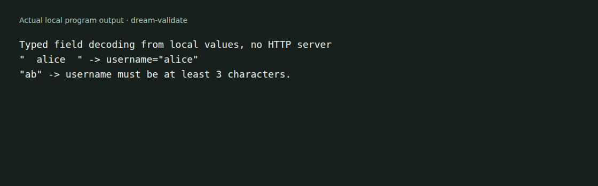

# dream-validate

Decode and validate form, query, route, session and JSON inputs in OCaml Dream
applications. Use the runtime decoders directly, or derive record decoders with
the included PPX.



The example uses local field lists. It starts no HTTP server and handles no
real user data. See [capture details](docs/demo/README.md).

## Build and try the example

Use an OCaml 5.2 or later switch, Dune 3.22 or later, and a compatible Dream
implementation. This library's request adapters target the synchronous Dream
API used by the `cohttp-eio` branch of
[Microapps-Labs/dream-cohttp-eio](https://github.com/Microapps-Labs/dream-cohttp-eio/tree/cohttp-eio).
Do not assume the upstream Lwt-based API has the same return types.

```sh
git clone https://github.com/Microapps-Labs/dream-validate.git
cd dream-validate
opam install . --deps-only --with-test
opam exec -- dune exec examples/demo/main.exe
opam exec -- dune runtest
```

For the tested dependency setup, clone the cohttp-eio branch alongside this
repository and pin both packages from that same checkout:

```sh
git clone --branch cohttp-eio https://github.com/Microapps-Labs/dream-cohttp-eio.git ../dream-cohttp-eio
opam pin add --no-action dream-pure ../dream-cohttp-eio
opam pin add --no-action dream ../dream-cohttp-eio
```

Run these pins before the dependency-install command above.
The local example trims `"  alice  "` to `"alice"` and applies a minimum-length
validator to `"ab"`.

## Runtime decoding

`Source.of_fields` builds an input source. `Form.field` selects a value and can
trim or validate it. `Form.decode` returns a typed value or a list of errors
with `field`, `code` and `message` fields. The
[runnable example](examples/demo/main.ml) shows the complete call.

Query, route, session and JSON adapters are defined in the
[public interface](lib/dream_validate.mli). Your handler decides how errors map
to an HTTP response and which values are safe to accept.

## Derived record decoders

The `dream-validate.ppx` library provides `dream_form` and `dream_json` derivers.
Attributes can rename input keys, trim strings and add validation rules. See
[the record examples](docs/record-decoders.md) for supported fields and generated
functions. Those functions do not replace authorization or application rules.

## Development

The tests cover runtime and PPX behavior. Request-adapter behavior also depends
on the Dream version linked by your application; a local decoder capture is not
an end-to-end web-server qualification.

[MIT](LICENSE.md).
